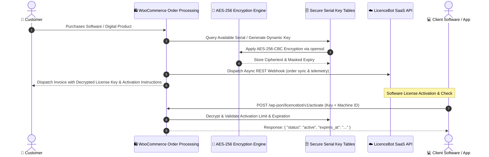

# LicenceBot Helper Plugin for WooCommerce

[](https://wordpress.org)
[](https://woocommerce.com)
[](https://www.php.net)
[]()
[]()

An enterprise WordPress/WooCommerce plugin engineered for **automated software license generation, AES-256 encrypted serial key storage, real-time license verification APIs**, and an integrated suite of e-commerce conversion tools (abandoned cart recovery, live chat, dynamic visitor alerts, and sales proof widgets) connected to the [LicenceBot](https://licencebot.com) cloud dashboard.

---

## 🏗️ Architecture & License Delivery Flow



---

## 🌟 Key Functional Capabilities

### 1. 🔑 Cryptographic License & Serial Number Engine
- **AES-256-CBC Encryption at Rest:** Serial numbers and license keys are encrypted in the database (`AC_Serial_Numbers_Encryption`) utilizing dynamic per-installation SHA-256 salted hashes and OpenSSL ciphers.
- **Dynamic Key Generation:** Automatic key generation matching custom formatting rules (e.g., `XXXX-XXXX-XXXX-XXXX`), pre-loaded CSV key pools, or variable product assignments.
- **Validity & Expiration Controls:** Configure validity limits (lifetime, days, or hard expiration dates) and device activation maximums per license key.

### 2. ⚡ RESTful License Verification APIs
Provides high-performance, token-authenticated REST endpoints for external software, desktop apps, and WordPress plugins:
- `POST /wp-json/licencebot/v1/activate` — Validate key, bind Hardware Machine ID (HWID) or domain, and increment activation counters.
- `POST /wp-json/licencebot/v1/deactivate` — Unbind client instances during hardware migration.
- `GET /wp-json/licencebot/v1/check` — Fast remote status polling with transient caching to avoid database bottlenecks.

### 3. ☁️ LicenceBot Cloud Auto-Connect
- **Token Exchange Onboarding:** Zero-configuration setup via organization tokens or secure handshake tokens (eliminating manual API key copy-pasting).
- **Asynchronous Webhook Pushes:** Dispatches background order events (`class-ac-serial-numbers-webhook.php`) to the LicenceBot SaaS dashboard with retry mechanics.
- **Config Synchronization:** Pulls remote widget settings and feature flags, automatically cached in WordPress transients.

### 4. 🛒 Cart Abandonment Recovery
- **Real-Time Capture:** Tracks guest and logged-in cart activity on key-up events.
- **Automated Follow-ups:** Trigger scheduled recovery emails with unique single-use discount coupon codes before customers bounce.

### 5. 📈 Conversion & Social-Proof Growth Widgets
Built-in lightweight front-end widgets without bloated external dependencies:
- **Product Page Social Proof:** Live sales counters, recent buyer popups, and real-time visitor alert badges.
- **Urgency Drivers:** Dynamic countdown timers for flash sales and limited software release windows.
- **Customer Support Suite:** Integrated floating contact forms, helpdesk support ticket bridges, and live chat widget embedder.

---

## 📂 Codebase Organization

```
LicenceBot-Helper-Plugin/
├── assets/                          # Front-end widget scripts, stylesheets, and icons
├── examples/
│   └── api-test.php                 # PHP curl script demonstrating remote activation & checks
├── i18n/                            # Localization files (.pot, .po, .mo)
├── includes/
│   ├── admin/
│   │   ├── class-ac-serial-numbers-admin.php          # Admin menu routing & dashboard
│   │   ├── class-ac-serial-numbers-admin-metaboxes.php# Product page license settings
│   │   └── class-ac-serial-numbers-admin-settings.php # Encryption & connection settings
│   ├── class-ac-serial-numbers-encryption.php         # AES-256-CBC cipher implementation
│   ├── class-ac-serial-numbers-api.php                # Public REST API routes
│   ├── class-ac-serial-numbers-webhook.php            # Webhook dispatch engine
│   ├── class-ac-serial-numbers-cart-recovery.php      # Abandoned checkout tracker
│   ├── class-ac-serial-numbers-order-handler.php      # WooCommerce order hooks & allocation
│   ├── licencebot-key-tools.php                       # Batch generator & CSV import/export
│   └── licencebot-shortcodes.php                      # Customer account license management UI
├── licencebot-helper.php            # Plugin bootstrap file
└── uninstall.php                    # Safe database cleanup on removal
```

---

## 🛠️ Requirements & System Prerequisites

| Dependency | Minimum Requirement | Tested Up To |
|---|---|---|
| **WordPress** | 6.0+ | 6.8+ |
| **WooCommerce** | 6.0+ | 10.7+ |
| **PHP** | 7.4+ | 8.3+ |
| **PHP Extensions** | `openssl`, `mbstring`, `json`, `curl` | Required |

---

## ⚙️ Installation & Developer Usage

### Installation
1. Package the plugin files into a ZIP archive: `LicenceBot-Helper-Plugin.zip`.
2. In WordPress Admin, go to **Plugins $\rightarrow$ Add New $\rightarrow$ Upload Plugin**.
3. Upload and click **Activate**.

### Verifying a License via REST API (Example)

```bash
curl -X POST "https://yourstore.com/wp-json/licencebot/v1/activate" \
     -H "Content-Type: application/json" \
     -d '{
       "license_key": "XXXX-XXXX-XXXX-XXXX",
       "product_id": 123,
       "instance_id": "client-mac-address-or-domain"
     }'
```

**Expected JSON Response:**
```json
{
  "status": "success",
  "message": "License activated successfully.",
  "data": {
    "license_key": "XXXX-XXXX-XXXX-XXXX",
    "expires_at": "2027-12-31 23:59:59",
    "activations_remaining": 2
  }
}
```

---

## 📄 License
This plugin is licensed under the **GNU General Public License v2.0 or later (GPL-2.0+)**.
